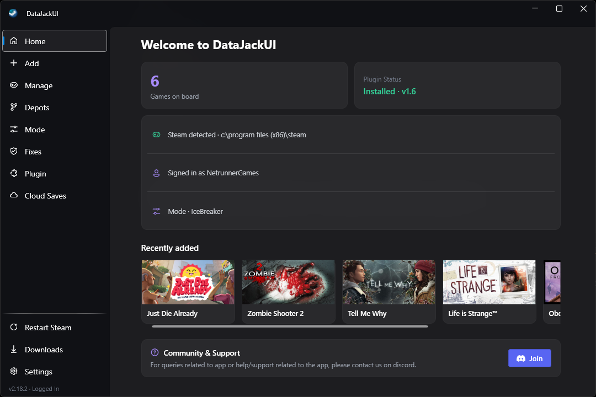

<div align="center">


# DataJackUI

A modern desktop interface for Steam manifest management, native hook injection, and store plugin integration.

<a href="https://github.com/NetrunnerGames/DataJackUI/releases/tag/v2.15.0"></a>
<a href="https://github.com/NetrunnerGames/IceBreaker/releases/tag/v2.2"></a>
<a href="https://github.com/NetrunnerGames/Jack-in/releases/tag/v1.3"></a>
<a href="https://dotnet.microsoft.com/"></a>
<a href="LICENSE"></a>


<br ><br >

</div>

> [!IMPORTANT]
> **DISCLAIMER & NOTICE**
> DataJackUI is an independent open-source client utility. It is not affiliated with, endorsed by, or associated with Valve Corporation or Steam. All game titles, trademarks, and registered assets belong to their respective owners.

## Overview

DataJackUI provides an interface for Steam manifest acquisition, native DLL hook administration, game repair routines, and CEF store plugin control. It includes configurable DNS-over-HTTPS resolution and direct Steam storefront search integration.

## Key Capabilities

* **Dark Acrylic Interface**: Native Windows 10/11 Acrylic backdrop rendering paired with a dark-tinted background container grid.
* **Store Query Engine**: Storefront search queries filtered strictly for real games to populate Top Sellers and Popular New Releases.
* **Jack-in Plugin Backend**: Native RPC integration matching the `Jack-in` Steam CEF store plugin for 1-click manifest addition inside the Steam client.
* **Hook & Unlocker Administration**: Management interface for OpenSteamTools and IceBreaker backend hooks.
* **Fixes & Diagnostics**: Integrated game fix repository and repair workflows with file backups.
* **Cloud Saves**: Backup, sync, and restore game saves locally with automatic pre-restore safety snapshots and customizable local backup paths (cloud provider integrations coming soon).
* **Cloudflare DoH Resolution**: Fallback DNS over HTTPS (`https://1.1.1.1/dns-query`) for networks where DNS lookup is restricted or throttled.

## Privacy & Telemetry Disclosure

We believe in complete transparency regarding network calls, telemetry, and user privacy.

For a detailed technical breakdown of our anonymous app launch ping, zero-PII architecture, and ephemeral in-memory OAuth token handling, please see our dedicated [Privacy Policy](PRIVACY.md).

## Tasks

- [ ] UWP Tab with UWP Games
- [ ] Custom fixes list
- [ ] D* Games Activation

## Installation & Downloads

> [!TIP]
> For standard installation, use the standalone installer (`DataJackUI-win-Setup.exe`). Portable builds are also available for zero-installation deployment.

* **Installer**: Download `DataJackUI-win-Setup.exe` from [Releases](https://github.com/NetrunnerGames/DataJackUI/releases/tag/v2.15.0).
* **Portable**: Download `DataJackUI-win-Portable.zip` from [Releases](https://github.com/NetrunnerGames/DataJackUI/releases/tag/v2.15.0).
* **Steam CEF Plugin**: Download `plugin.zip` from the [Jack-in Repository](https://github.com/NetrunnerGames/Jack-in/releases/tag/v1.3) and extract it into your Steam client plugins directory.

## Building from Source

### Prerequisites
* .NET 8.0 Desktop SDK
* Windows 10 or 11 (x64)

### Local Development Build
```powershell
git clone https://github.com/NetrunnerGames/DataJackUI.git
cd DataJackUI

# Publishes and launches local framework-dependent binary
.\run_local.ps1
```

### Packaging Release Packages
```powershell
# Compiles framework-dependent binaries and generates Velopack installer packages
.\build_release.ps1 -d 2.10.0 -p 1.0
```

## Acknowledgments

DataJackUI is developed using architecture adapted from community open-source projects:

[](https://github.com/madoiscool/LuaTools) [](https://github.com/velopack/velopack) [](https://github.com/lepoco/wpfui) [](https://github.com/OpenSteam001/OpenSteamTool) [](https://github.com/Midrags/SFF) [](https://github.com/acidicoala/SmokeAPI)

## License

This project is licensed under the [MIT License](LICENSE).
